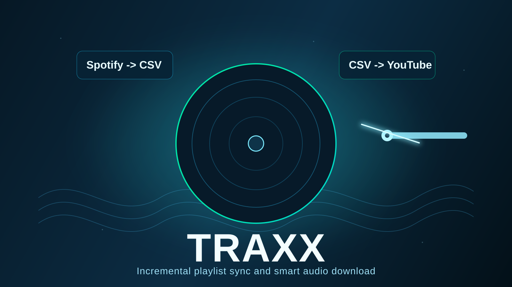

# Traxx



Spotify playlist sync to CSV and selective YouTube audio download from a single CLI.

## Features

- Incremental playlist sync with one CSV per Spotify playlist.
- Persistent download state through the `downloaded` column.
- Strict YouTube candidate matching to reduce wrong downloads.
- Packaged Windows build support alongside source-based development.

## Install

### Package manager

```bash
python -m pip install .
traxx --help
```

### Release binary

```powershell
.\traxx.exe --help
```

Place `.env` next to `traxx.exe` for the packaged app.

### Build from source

```powershell
.\packaging\windows\build_windows.ps1
```

See [docs/BUILD_FROM_SOURCE.md](docs/BUILD_FROM_SOURCE.md) for source setup, packaging, and local build details.

## Configure

Create `.env` from [`.env.example`](.env.example):

```env
SPOTIFY_CLIENT_ID=your_client_id
SPOTIFY_CLIENT_SECRET=your_client_secret
SPOTIFY_REDIRECT_URI=http://127.0.0.1:8888/callback
SPOTIFY_PLAYLIST_URL=https://open.spotify.com/playlist/...
```

## Run

```bash
traxx
traxx --playlist-url "https://open.spotify.com/playlist/..."
traxx --dry-run --limit 3
```

### Download in batches

```powershell
.\.venv\Scripts\python.exe traxx.py --limit 300
```

Stops after 300 successful downloads, or when no pending tracks remain.
The CSV is saved after each download. Run the same command later to download
the next 300 pending tracks; rows marked `downloaded=yes` are skipped.
Failed matches or downloads remain `downloaded=no` and do not count toward the
limit. They are retried on the next run. Keep the CSV to preserve progress.
`--limit` must be positive; omit it to process all pending tracks.
With `--dry-run`, it limits previews instead of successful downloads.

These changes apply to the Python source; rebuild `traxx.exe` to use them in
the packaged application.

### Download from an existing CSV

```powershell
traxx --csv "output/DnB2.csv" --limit 300
traxx --csv "output/DnB2.csv" --dry-run --limit 3
```

This mode skips Spotify authentication and synchronization. Only rows in the
given CSV are processed, and successful downloads update that same file's
`downloaded` column. Existing `downloaded=yes` rows are skipped. A missing status
column is added automatically. Keep the file to resume in later sessions.
Downloads go into `downloads/<CSV filename without extension>/` (or under
`--download-dir`). CSV files must be comma-separated UTF-8, with `track_name`
and `artists` columns; Traxx exports can be used directly. `duration_ms` is
recommended for matching. Dry runs leave the input file unchanged.
`--csv` cannot be combined with a playlist argument or `--no-download`.

## Project Layout

- `traxx.py`: thin executable entrypoint.
- `traxx_core/`: application logic.
- `traxx_core/downloading/`: internal downloader modules.
- `packaging/`: Windows build scripts, spec file, and icon assets.
- `docs/`: contribution and project-reference docs.

## Contributing

- Contribution guide: [docs/CONTRIBUTING.md](docs/CONTRIBUTING.md)
- Build from source: [docs/BUILD_FROM_SOURCE.md](docs/BUILD_FROM_SOURCE.md)
- Project scope memo: [docs/PROJECT_SCOPE.md](docs/PROJECT_SCOPE.md)
